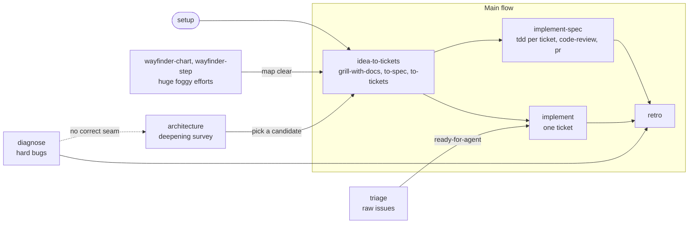

# LRIL SDLC Archon Workflows

An [Archon](https://archon.diy) workflow pack that runs **[Matt Pocock's skills](https://www.aihero.dev/skills)** (the [`mattpocock/skills`](https://github.com/mattpocock/skills) engineering flow) as governed, resumable, gated workflows.

Matt's skills fix the four failure modes of agentic coding: misalignment (the agent didn't do what you wanted), verbosity (no shared language), code that doesn't work (no feedback loops), and a ball of mud (no care for design). This pack keeps his methodology intact and adds what a workflow engine is good at. Every step that can be checked by code is checked by code. Every public write is performed by a script and read back. Every interview happens at an interactive gate, so you answer it on your own time, and a run can stop and resume.

```bash
archon plugin install seanrobertwright/lril-sdlc-archon
archon workflow run seanrobertwright/lril-sdlc:setup --no-worktree
archon workflow run seanrobertwright/lril-sdlc:idea-to-tickets --branch feat/saved-cards "Let customers save a card at checkout"
```

## The flow

The pack follows the flow map in Matt's [`/ask-matt`](https://github.com/mattpocock/skills/blob/main/skills/engineering/ask-matt/SKILL.md): one **main flow** from idea to ship, **on-ramps** that merge onto it, and **upkeep** that runs beside it.



| Workflow | Matt's skills | Mode | What it leaves behind |
|---|---|---|---|
| `setup` | `/setup-matt-pocock-skills` | AFK, no AI | `docs/agents/*.md`, an `## Agent skills` block, GitHub labels |
| `idea-to-tickets` | `/grill-with-docs` (`grilling`, `domain-modeling`), `/to-spec`, `/to-tickets`, `prototype`, `research`, `codebase-design` | Interactive | A spec and tracer-bullet tickets on your tracker; `GLOSSARY.md` and ADRs committed |
| `implement` | `/implement` (`tdd`, `codebase-design`, `code-review`, `pr`) | AFK | One ticket built test-first, gated, reviewed on two axes, committed (optional PR) |
| `implement-spec` | `/implement-spec` (`tdd`, `codebase-design`, `code-review`, `pr`) | AFK | A whole spec on one integration branch, every ticket gated, one review, one PR |
| `code-review` | `code-review` | AFK, read-only | `code-review.md`: Standards and Spec, side by side |
| `triage` | `/triage` (`grilling`, `domain-modeling`) | Interactive | Labels, an agent brief or triage notes, `.out-of-scope/` records; glossary and ADR edits committed |
| `diagnose` | `diagnosing-bugs` (`tdd`, `codebase-design`) | AFK | A proven red→green feedback loop, a regression test, the root cause in the commit |
| `architecture` | `/improve-codebase-architecture` (`codebase-design`, `domain-modeling`) | AFK, read-only | A visual HTML report of deepening opportunities |
| `retro` | `/retro` (`writing-for-agents`) | AFK, read-only | `retro.md`: environment improvements, most severe first |
| `wayfinder-chart` | `/wayfinder` charting (`grilling`, `domain-modeling`, `research`) | Interactive | A `wayfinder:map` of decision tickets; research tickets resolved |
| `wayfinder-step` | `/wayfinder` working (`grilling`, `domain-modeling`, `prototype`, `research`) | Interactive or AFK | One decision ticket resolved and indexed on the map |

### How the skills are used

Matt splits his skills on one axis. **User-invoked** skills (`/grill-with-docs`, `/to-spec`, `/implement`, …) orchestrate. **Model-invoked** skills (`grilling`, `tdd`, `code-review`, `codebase-design`, …) hold the reusable discipline. In this pack, **each workflow is the orchestrator**: its DAG encodes the user-invoked skill's process, step by step, with its gates. **Each AI node loads the model-invoked skills it needs** from the `mattpocock-skills` Claude plugin, through Archon's per-node `skills:` selection. A node never sees a skill it doesn't use.

Matt's [context-hygiene](https://github.com/mattpocock/skills/blob/main/skills/engineering/ask-matt/PHASE-BOUNDARIES.md) rules carry over:

- `idea-to-tickets` runs grilling, spec and tickets in **one unbroken session**, so the spec and tickets build on the interview itself rather than a summary of it. The verbatim transcript is also kept on disk.
- `implement-spec` gives **every ticket a fresh context**: the ticket is self-contained, so the last one's context is disposable.
- Reviewers always start **fresh**, receiving only the diff, and the two review axes run in parallel so neither pollutes the other.
- `diagnose` **resumes** the feedback-loop session for the fix, because the fix needs that context verbatim.

### The gates

Matt's skills say what "done" means. The pack checks it with code wherever it can:

| Gate | Where | What a script proves |
|---|---|---|
| Tracker configured | every tracker-aware workflow | `docs/agents/issue-tracker.md` exists and names GitHub or local markdown |
| Plugin version | `setup` | `mattpocock-skills` is installed, enabled, and at v1.3 or later |
| Shape is publishable | `idea-to-tickets` | the spec has every `/to-spec` section; tickets have acceptance criteria, real blockers, and no cycles. The interview loop can't end until this passes. |
| Green | `implement`, `implement-spec` (per ticket) | the implementer declared green; **its declared check commands are re-run here** and pass; the work is committed; nothing is left dirty. A command that fails is run once more. One that passes then counts as passed but is marked **flaky** in the check record, the outcome and the PR body. A gate that fails on its checks ends with the `archon workflow resume` command that reruns it. |
| Up to date with the base | `implement`, `implement-spec` (before the PR) | the branch merges the base branch (`origin/<base>`, fetched just now) before the PR is written, so the PR opens against the base it will land on. A clean merge re-runs the last green gate's check commands. A conflicted one goes to one fresh resolver, which commits the merge or aborts it, and the Green gate re-runs after it. The PR body's diff is taken against that base. It merges and never rebases, because the branch may already be pushed. |
| Red-capable loop | `diagnose` | the feedback-loop command **fails 3/3 times on the unfixed code, with the user's symptom** in the output. No red loop, no hypotheses. |
| Green loop | `diagnose` | the same command passes 3/3, the regression test passes (or the missing seam is documented), and no `[DEBUG-…]` lines are left in the diff |
| Triage outcome | `triage` | exactly one category and one state; the AI disclaimer; an agent brief, triage notes, or a close shaped as `/triage` requires; `.out-of-scope/` only for a rejected enhancement |
| Approved as shown | `idea-to-tickets`, `triage`, `wayfinder-chart`, `wayfinder-step` | the draft a session hands on (spec and tickets, outcome, map, resolution) is unchanged since a gate showed it, and you approved that gate with no comment. A session can't publish on its own say-so, or on a reply that never arrived. |
| Report complete | `architecture`, `retro` | the report exists and renders every candidate |
| Public writes | everywhere | issues, labels, comments, sub-issues, blocked-by edges and PRs are written by a script and **read back** |

The pack never hardcodes a toolchain. Implementers discover the project's own type-check, lint and test commands and report them, and the gate re-runs exactly those.

## Prerequisites

- **Archon** v0.11.1 or later, signed in to Claude (`archon doctor`).
- **Claude Code** with the **`mattpocock-skills`** plugin at **v1.3 or later**, installed from Matt's own marketplace. The `claude-plugins-official` listing is older than v1.3, and the pack names the plugin by its id, `mattpocock-skills@mattpocock`:
  ```bash
  claude plugin marketplace add mattpocock/skills
  claude plugin install mattpocock-skills@mattpocock   # or: claude plugin update mattpocock-skills@mattpocock
  ```
- **git** and **[bun](https://bun.sh)** on `PATH`. The deterministic nodes are TypeScript on Bun, with no npm dependencies.
- For the GitHub tracker: **`gh`**, authenticated, in a clone with a GitHub `origin`.

## Install

```bash
archon plugin install seanrobertwright/lril-sdlc-archon          # default branch
archon plugin install seanrobertwright/lril-sdlc-archon@v0.1.0   # a tagged version
```

Entrypoints run as `seanrobertwright/lril-sdlc:<entrypoint>`, for example `seanrobertwright/lril-sdlc:implement`. To customise the prompts for one project, copy the pack into it with `archon plugin copy seanrobertwright/lril-sdlc-archon`. The copies then run by their YAML names (`lril-implement`, …).

## Using it

### 1. Set up the repo, once

```bash
archon workflow run seanrobertwright/lril-sdlc:setup --no-worktree
```

It picks GitHub when `origin` is on github.com, otherwise local markdown under `.scratch/`. Override with `--input tracker=local`. It writes Matt's own seed templates, so his skills work in the same repo outside Archon too. Existing `docs/agents` files are kept (`--input overwrite=true` replaces them).

### 2. Shape an idea (interactive)

```bash
archon workflow run seanrobertwright/lril-sdlc:idea-to-tickets --branch feat/saved-cards "Let customers save a card at checkout"
```

Interactive workflows pause at a gate after every round. Read the round (the gate shows an excerpt; the full text is in the run's artifacts under `shape/current-round.md`) and answer it:

```bash
archon workflow approve <run-id> "Q1 yes. Q2: only signed-in Customers. Q3 yes"
```

"yes" accepts the recommended answer. When a round presents the final draft, **approve with no comment** to publish it exactly as shown, or with a comment to revise it. The gate's status line still reads "No completion condition met" at that point: the run completes on your bare approval. `archon workflow get <run-id> --json` shows where a run stands. The web console (`archon serve`) has the same gate controls.

### 3. Build it

```bash
# the whole spec, ticket by ticket, on the same branch
archon workflow run seanrobertwright/lril-sdlc:implement-spec --branch feat/saved-cards --input spec=#40 --detach

# or one ticket
archon workflow run seanrobertwright/lril-sdlc:implement --branch feat/saved-cards-03 --input ticket=#43 --input pr=true --detach
```

With the local tracker, pass paths instead: `--input spec=.scratch/saved-cards/spec.md`, `--input ticket=.scratch/saved-cards/issues/03-saved-cards.md`.

### 4. Look back

```bash
archon workflow run seanrobertwright/lril-sdlc:retro --input run=<run-id> --detach
```

### On-ramps and upkeep

```bash
archon workflow run seanrobertwright/lril-sdlc:triage                      # what needs my attention?
archon workflow run seanrobertwright/lril-sdlc:triage --input target=#42   # triage one issue with me
archon workflow run seanrobertwright/lril-sdlc:diagnose --branch fix/double-charge "Checkout charges the card twice when the gateway times out" --detach
archon workflow run seanrobertwright/lril-sdlc:architecture --detach
archon workflow run seanrobertwright/lril-sdlc:code-review --input base=main --detach
archon workflow run seanrobertwright/lril-sdlc:wayfinder-chart "Rewrite billing on an event-sourced ledger"
archon workflow run seanrobertwright/lril-sdlc:wayfinder-step --input map=#12
```

## Where this deviates from the skills, and why

- **`implement-spec` builds the frontier serially**, one fresh-context implementer per ticket on the integration branch, rather than as parallel subagents in separate worktrees. Each ticket passes a deterministic gate before the next one starts, and a failed run resumes at the open ticket. Parallel waves are a planned evolution.
- **No human confirms test seams during AFK builds.** `/tdd` asks you to confirm seams. Here they're agreed during `idea-to-tickets` (the `/to-spec` seam round) and read from the spec's *Testing Decisions*. A seam an implementer had to choose itself is reported as **unconfirmed** for the reviewer.
- **Prototypes and research go to the run's artifacts**, outside the repo, and are linked from the spec or ticket. A UI prototype that must run inside the project is recommended as a separate `/prototype` session on its own branch.
- **Wayfinder research findings are posted as the ticket's resolution**, rather than kept on a throwaway `research/<name>` branch.
- **`setup` is deterministic.** It applies Matt's recommended defaults instead of interviewing you; run `/setup-matt-pocock-skills` in Claude Code if you want the interview, or a tracker other than GitHub or local markdown.

## Archon version notes

- Every AI node declares `plugins: [mattpocock-skills@mattpocock]`. Archon v0.11.1 loads all installed Claude plugins and warns that `plugins` is an unknown key. From the next Archon release, nodes load only the plugins they name, and this declaration is what keeps the skills available.
- Archon warns that plugin-qualified skills (`mattpocock-skills:tdd`) aren't on disk. That's expected: Claude resolves plugin skills itself.
- Gate replies reach a session through `with: { reply: "$LOOP_USER_INPUT" }`, and the command reads `$INPUTS.reply`. Archon v0.11.1 substitutes `$LOOP_USER_INPUT` into a `loop_group` body node's YAML fields, but not into the command file the node loads, so reading it there directly always gives an empty reply ([coleam00/Archon#3954](https://github.com/coleam00/Archon/issues/3954)). Drop the binding once that is fixed.
- An interactive `loop_group` in Archon v0.11.1 pauses after its first iteration even when `until_bash` passes. On every later iteration, a passing `until_bash` ends the loop at once, with no gate. So each session's `until_bash` runs its validator with `--gate`. That passes only when the reply that opened the iteration is a bare approve (Archon records it as `Approved`) and the draft is unchanged since the last gate showed it.
- Interactive sessions use `loop_group` with `interactive: true`, which Archon marks deprecated in favour of a future gate composition. It's the supported mechanism today.

## Developing the pack

```bash
cd tools && bun install && cd ..
tools/dev.sh            # validate every lril workflow, typecheck, unit + integration tests, all dry-run fixtures
tools/dev.sh test lril-implement
```

Archon discovers fixtures only under a project's `.archon/workflows/`, so `tools/dev.sh` mirrors the pack into a gitignored `.archon/workflows/lril-sdlc/` first. `tools/tests/local-flow.test.ts` drives the real scripts end to end against a throwaway repo on the local tracker.

Each workflow lives in its own folder: `<name>.yaml`, `commands/*.md` (prompts), `scripts/*.ts` (deterministic nodes), `bin/*.ts` (validators bundled into a run for `until_bash`), and `fixtures/*.stubs.yaml`. Logic shared by several scripts lives in `.shared/`.

## Credits and license

The methodology, the process each workflow encodes, and the templates in `setup/templates/` come from **[Matt Pocock's skills](https://github.com/mattpocock/skills)** (MIT, © 2026 Matt Pocock). See [NOTICE.md](NOTICE.md). The skills themselves are loaded from his plugin at run time, not copied here. Learn the thinking behind them at [aihero.dev/skills](https://www.aihero.dev/skills).

This pack is MIT licensed. See [LICENSE](LICENSE).
